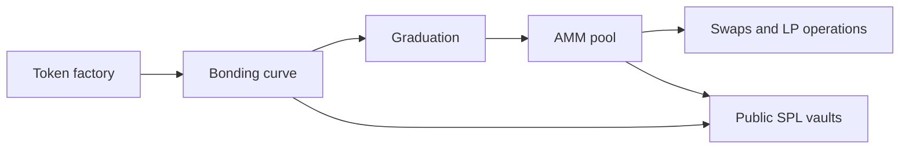

<div align="center">
  <a href="https://privacycash.fun"></a>
  <h1>Zolana</h1>
  <p><strong>GHOST engineering · Independent Solana Privacy Rings integration</strong></p>
  <p><a href="https://privacycash.fun">Website</a> · <a href="https://github.com/ghostrings/zolana">Repository</a> · <a href="https://github.com/ghostrings">GHOSTRINGS</a> · <a href="docs/engineering/ARCHITECTURE.md">Architecture</a> · <a href="docs/engineering/VALIDATION.md">Validation</a> · <a href="contrib/helius/README.md">Helius collaboration</a></p>
  <p><code>TypeScript</code> &nbsp; <code>Node 22</code> &nbsp; <code>Solana</code> &nbsp; <code>Meteora DBC</code> &nbsp; <code>SPR 0.9.0-alpha</code></p>
</div>

> [!IMPORTANT]
> **Engineering candidate — not a deployed Custom Ring.** The existing platform uses the Default Ring on Solana mainnet. The new GHOST Ring lab uses fictional assets and participants. This checkout has no actual Custom Ring program, proof integration, anonymous relayer or operational auditor. The earlier GitHub run passed application tests and type-checking, but was cancelled during Vite. The merged candidate needs fresh CI, a complete build and independent review. Do not use this candidate with real funds.

## What is GHOST?

GHOST is the engineering foundation behind [privacycash.fun](https://privacycash.fun): token launches, a browser-based private wallet, confidential inventory settlement, and market analytics with clearly defined data boundaries. We are exploring supported programmable privacy through Helius Custom Rings without replacing the existing launchpad or inventing new cryptography.

| Product | Implementation in this checkout | Next milestone |
| :--- | :--- | :--- |
| **GHOST Launch** | Existing Meteora DBC launch, trade, fee and graduation paths | Preserve and regression-test |
| **GHOST Wallet** | Existing browser-based Default Ring wallet; ring readiness notice | Supported ring enrollment and balances |
| **GHOST Ring** | Local policy model, fictional transfers, atomic settlement and fail-closed readiness API | Actual confidential devnet conformance |
| **GHOST Intelligence** | Public protocol vault/index observations and separately labelled synthetic reporting | Scoped, independently reviewed auditor reports |
| **GHOST Markets (Program B)** | Separate Anchor market program source: token factory, curve, graduation, AMM and liquidity; public SPL settlement only | Rust/SBF compilation and local-validator conformance |

Public pool execution remains public. Default Ring transfers conceal token and amount, not counterparties. The existing optional Ghost desk uses two confidential settlement legs and holds inventory; it is not an AMM. Neither the lab nor public vault data establishes anonymity, beneficial ownership, audited private balances or regulatory compliance.

## System architecture


The research lab is deliberately isolated from production transaction builders. `GET /api/custom-rings/status` is read-only; it reports `canTransact: false`, `network: null`, `ringProgram: null`. The research target cannot enable transactions. See the [trust boundaries and architecture decisions](docs/engineering/ARCHITECTURE.md) and [original platform reference](PLATFORM.md).

## Reproduce the evidence


The local preparation environment reproduced all 17 standalone tests, a fixed-seed 2,000-operation state-machine test, the 229-file v23 SHA-256 baseline and the exact committed synthetic demo. These are **model and source checks**, not tests of the Helius on-chain protocol or a security audit.

**Quick check** — requires Node 22 and an installed compatible TypeScript compiler (the locked npm install provides one):

```sh
npm run ghost:baseline
npm run ghost:check
npm run --silent ghost:demo
```

**Full checkout** — use the Node version in `.node-version` (22.22.0) and the checked-in npm lockfile:

```sh
npm ci
npm run verify
npm run --silent ghost:demo
```

No wallet, API key, devnet SOL or mainnet account is needed for these checks. The [engineering workflow](.github/workflows/ci.yml) runs on pushes to `main`, PRs and manual dispatch with read-only permissions and no deploy step. It verifies the baseline, standalone model, Vitest tests, production build and deterministic fixture. [View GitHub Actions](https://github.com/ghostrings/zolana/actions). The owner-provided GitHub log for the preceding application checkout reports 943/943 Vitest tests (39 files, including 9 HTTP tests), 17/17 standalone checks, 229/229 baseline hashes and successful TypeScript type-checking. Vite was interrupted by a cancelled run; neither the frontend nor server build is verified. The workflow now keeps active runs alive when new commits arrive and reports build stages separately. See [CI incident and recovery](docs/engineering/CI_RECOVERY.md). Fresh CI and browser smoke testing remain pending for this merged checkout. [Validation record](docs/engineering/VALIDATION.md) · [Fixture walkthrough](docs/engineering/DEMO.md).

### Local browser preview

After `npm ci`, run `npm run dev:web` and open `http://localhost:5173/ghost.html` or `http://localhost:5173/ghost-intelligence.html`. Use a fresh development browser profile, not a production wallet. The policy lab uses local fictional data; public index data requires the existing configured backend. For the full app, see [PLATFORM.md](PLATFORM.md) and the [mainnet runbook](docs/MAINNET_RUNBOOK.md); the research candidate is not approved for live deployment.

## Custom Ring research target

[config/ghost-ring.research.json](config/ghost-ring.research.json) defines the application-level research parameters. It is **not** an upstream deployment manifest.

| Parameter | Target |
| :--- | :--- |
| Mode / membership / assets | Anonymous / open / all supported |
| Blocklist / freeze / co-signing | Enabled |
| Auditor / emergency pause | Enabled |
| Permanent delegate | Disabled |
| Current execution | Local simulation only; no on-chain deployment |

Anonymous mode and unrestricted research parameters are not approved production settings. A real integration must establish supported upstream semantics, security, privacy and lawful operation before any live funds are admitted. Confidential devnet is the initial integration milestone.

## GHOST Markets — Program B (v26)

The new [GHOST Markets workspace](protocol/ghost-markets/README.md) contains an independent Anchor program candidate for market creation, a two-way bonding curve, permissionless graduation, constant-product swaps and proportional SPL liquidity shares. It is deliberately separate from the existing TypeScript application, the current Meteora routes and the Custom Ring research lab.



The dependency-free Node reference passed 31 tests, including 10,000 seeded pricing cases, 5,000 lifecycle scenarios and 128 committed vectors. The actual Rust program has not yet been compiled, run against a validator or deployed. Public SPL settlement is the only implemented on-chain path; no private settlement or ring activation is included. The placeholder program ID is not a deployment address.

- [V25 pricing RFC](protocol/markets/README.md) — historical research and pricing reference.
- [V26 account model](protocol/ghost-markets/docs/ACCOUNT_MODEL.md) — accounts and economic assumptions.
- [V26 validation gates](protocol/ghost-markets/docs/VALIDATION.md) — outstanding Rust, SBF and localnet requirements.
- [Program B workflow](.github/workflows/ghost-markets-program.yml) — reference and Rust checks; manually dispatch for the heavier localnet build and conformance suite. No production deployment.

Run the dependency-free V26 reference checks from the repository root:

```sh
node --test protocol/ghost-markets/tests/quote.test.mjs protocol/ghost-markets/tests/lifecycle.test.mjs
```

## Repository map

```text
shared/src/custom-rings/   immutable research target, model, synthetic reports
server/src/custom-rings/  read-only readiness endpoint; execution unavailable
web/                      existing application and GHOST research pages
ops/                      original operator tools and local verification
examples/ + tests/        deterministic demo, standalone and regression tests
evidence/                 immutable reference fixture, baseline and test records
docs/engineering/         architecture, validation, roadmap, publication guide
contrib/helius/           draft engineering intake, discussion and additive patch
protocol/markets/         V25 pricing RFC and reference
protocol/ghost-markets/   V26 Anchor candidate, math, fixtures and localnet tests
.github/                  CI, issue forms and pull request template
```

## Engineering roadmap


The [roadmap](docs/engineering/ROADMAP.md) specifies application exit criteria; [Program B release gates](protocol/ghost-markets/docs/VALIDATION.md) track the separate market program. We are seeking alignment with maintainers on official SDK/program versions, actual policy conformance, supported settlement and scoped audit reporting. The first proposed upstream contribution is a small documentation checklist; it is not a submitted or accepted PR. [Helius contribution kit](contrib/helius/README.md).

## Developer resources

| Resource | Purpose |
| :--- | :--- |
| [Architecture](docs/engineering/ARCHITECTURE.md) · [Privacy model](docs/PRIVACY_MODEL.md) | Current and future trust boundaries |
| [Validation](docs/engineering/VALIDATION.md) · [Demo](docs/engineering/DEMO.md) | Reproducible evidence and outstanding checks |
| [Roadmap](docs/engineering/ROADMAP.md) · [Changelog](CHANGELOG.md) | Release gates and candidate history |
| [Contributing](CONTRIBUTING.md) · [Security](SECURITY.md) · [Code of conduct](CODE_OF_CONDUCT.md) | Review, disclosure and collaboration |
| [GitHub publication guide](docs/engineering/PUBLISHING.md) | Manual upload, repository settings and release review |
| [Platform reference](PLATFORM.md) · [Docs index](docs/README.md) | Original application and operational documentation |
| [Helius integration intake](contrib/helius/HELIUS_INTAKE.md) | Collaboration draft for owner review |

**Upstream:** [Helius Privacy Rings](https://www.helius.dev/docs/privacy/concepts/overview) · [Custom Rings](https://www.helius.dev/docs/privacy/integration/custom-ring) · [Custom Ring reference](https://github.com/helius-labs/custom-privacy-rings) · [Privacy Rings SDK](https://github.com/helius-labs/privacy-rings) · [Example clients](https://github.com/helius-labs/privacy-ring-examples).

## Rights and independence

This project is independent and is not affiliated with or endorsed by Helius, Meteora, the Solana Foundation or privacycash.org. No source license has been selected. Rights remain reserved; keep this complete application private until the owner confirms publication rights, third-party obligations and security clearance. See [NOTICE](NOTICE.md). Repository: [ghostrings/zolana](https://github.com/ghostrings/zolana). CI status must be confirmed after manual upload.
