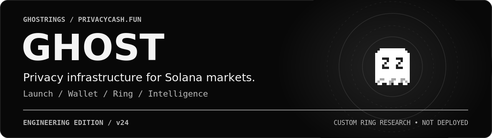
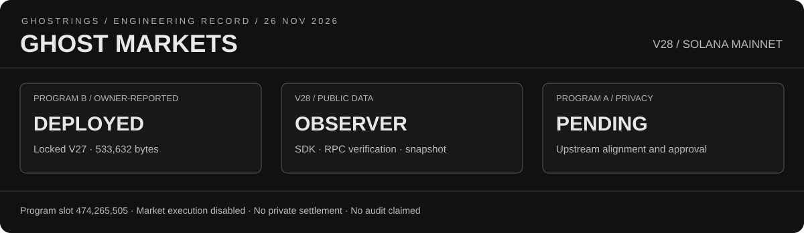
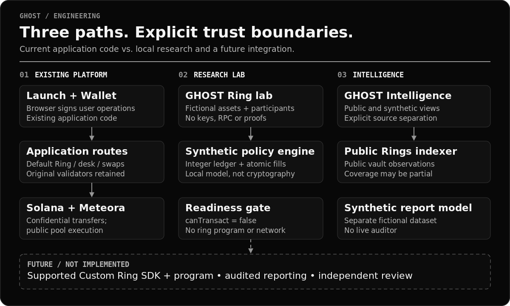
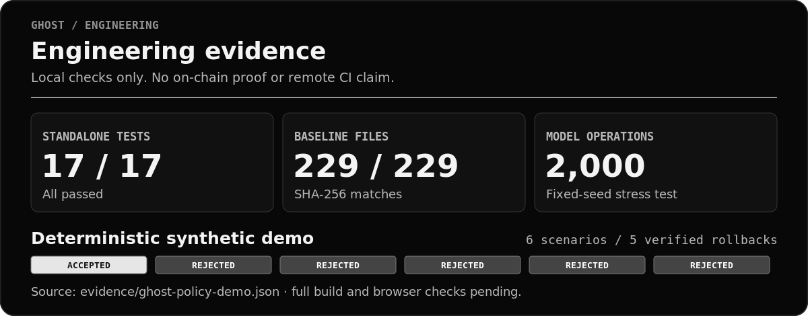
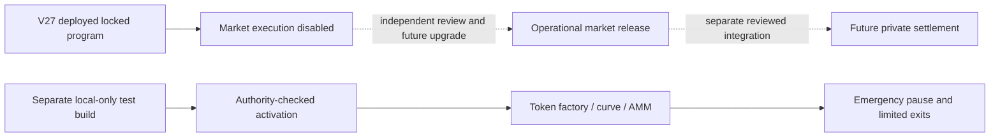

<div align="center">
  <a href="https://privacycash.fun"></a>
  <h1>Zolana</h1>
  <p><strong>GHOST engineering · Independent Solana Privacy Rings integration</strong></p>
  <p><a href="https://privacycash.fun">Website</a> · <a href="https://github.com/ghostrings/zolana">Repository</a> · <a href="https://github.com/ghostrings">GHOSTRINGS</a> · <a href="docs/engineering/ARCHITECTURE.md">Architecture</a> · <a href="docs/engineering/VALIDATION.md">Validation</a> · <a href="contrib/helius/README.md">Helius collaboration</a></p>
  <p><code>TypeScript</code> &nbsp; <code>Node 22</code> &nbsp; <code>Solana</code> &nbsp; <code>Meteora DBC</code> &nbsp; <code>SPR 0.9.0-alpha</code></p>
</div>

> [!IMPORTANT]
> **V28 public-source edition — GHOST Markets V27 deployed (locked); Custom Ring not deployed.** On 26 November 2026 the operator reported successful Solana mainnet deployment and exact byte verification. Market execution is disabled by the compiled default artifact, and the protocol configuration was uninitialized at verification. V28 adds read-only observation and local-only instruction previews, not a program upgrade. Independent security review is not evidenced. Do not use this market program with real funds.

## Mainnet milestone



| Field | Recorded value |
| :--- | :--- |
| Network | Solana mainnet-beta |
| Program B | [`5o9DeQkYHXM3DQkzo16mAt6doaYrfhq3Q5aabWMfMy2n`](https://explorer.solana.com/address/5o9DeQkYHXM3DQkzo16mAt6doaYrfhq3Q5aabWMfMy2n) |
| Deployment | [Transaction receipt](https://explorer.solana.com/tx/5TMpEwE2XkjWTfY42XShQPks3UoYrVEDWiHFdAzcCXeJcZ1wnu6AXyEaXefQn3cx3geMixMHjKtziSe6vtXaANjT) · slot `474265505` |
| Binary | 533,632 bytes · `2fba22c284791879f003aec3118c74fbd271f808f91b39e394e2654f9cc80d7d` |
| V27 test evidence | Owner-reported 15 Rust tests, 9 operational validator tests, 3 locked validator tests |
| Market execution | Locked at reported deployment; current state requires live verification |
| Program A / private settlement | Not implemented or registered |

The [public deployment record](deployments/mainnet/ghost-markets-v27.json) transcribes the owner's RPC result. Verify it with `npm run markets:observe -- status`. This package does not contain the exact production binary or generated IDL; the [evidence export runbook](deployments/mainnet/README.md) retrieves those from the owner's sealed release, checks them and copies only public release files. A hash match is not an independent audit. The owner subsequently reported successful finalized status and market-scan commands (zero markets at the observed slot), a successful public evidence export, and passing application checks. See [V28 observations](deployments/mainnet/v28-observations.json) and the [publication safety record](docs/engineering/PUBLICATION_CHECK.md).

**V28 SDK:** `npm run markets:check` for offline fixtures; `npm run markets:observe -- scan` for an explicit finalized public market snapshot; `npm run markets:observe -- history` for up to 10 public program signatures. New application page: `/ghost-markets` (requires a built frontend and configured RPC relay). [SDK documentation](docs/engineering/V28_MARKETS_SDK.md) · [Program A readiness](protocol/ghost-ring/README.md) · [Helius engineering request](contrib/helius/HELIUS_INTAKE.md).

## What is GHOST?

GHOST is the engineering foundation behind [privacycash.fun](https://privacycash.fun): token launches, a browser-based private wallet, confidential inventory settlement, and market analytics with clearly defined data boundaries. We are exploring supported programmable privacy through Helius Custom Rings without replacing the existing launchpad or inventing new cryptography.

| Product | Implementation in this checkout | Next milestone |
| :--- | :--- | :--- |
| **GHOST Launch** | Existing Meteora DBC launch, trade, fee and graduation paths | Preserve and regression-test |
| **GHOST Wallet** | Existing browser-based Default Ring wallet; ring readiness notice | Supported ring enrollment and balances |
| **GHOST Ring** | Local policy model, fictional transfers, atomic settlement and fail-closed readiness API | Actual confidential devnet conformance |
| **GHOST Intelligence** | Public protocol vault/index observations and separately labelled synthetic reporting | Scoped, independently reviewed auditor reports |
| **GHOST Markets (Program B)** | Owner-reported locked mainnet deployment; V28 read-only SDK, local public-SPL lifecycle | Independently reviewed operational upgrade, separate supported privacy integration |

Public pool execution remains public. Default Ring transfers conceal token and amount, not counterparties. The existing optional Ghost desk uses two confidential settlement legs and holds inventory; it is not an AMM. Neither the lab nor public vault data establishes anonymity, beneficial ownership, audited private balances or regulatory compliance.

## System architecture



The research lab is deliberately isolated from production transaction builders. `GET /api/custom-rings/status` is read-only; it reports `canTransact: false`, `network: null`, `ringProgram: null`. The research target cannot enable transactions. See the [trust boundaries and architecture decisions](docs/engineering/ARCHITECTURE.md) and [original platform reference](PLATFORM.md).

## Reproduce the evidence



The local preparation environment reproduced all 17 standalone tests, a fixed-seed 2,000-operation state-machine test, the 229-file v23 SHA-256 baseline and the exact committed synthetic demo. These are **model and source checks**, not tests of the Helius on-chain protocol or a security audit.

**Quick check** — requires Node 22 and an installed compatible TypeScript compiler (the locked npm install provides one):

```sh
npm run ghost:baseline
npm run ghost:check
npm run --silent ghost:demo
```

**Full checkout** — use the Node version in `.node-version` (22.22.0) and the checked-in npm lockfile:

```sh
npm ci
npm run verify
npm run --silent ghost:demo
```

No wallet, API key, devnet SOL or mainnet account is needed for these checks. The [engineering workflow](.github/workflows/ci.yml) runs on pushes to `main`, PRs and manual dispatch with read-only permissions and no deploy step. It verifies the baseline, standalone model, Vitest tests, production build and deterministic fixture. [View GitHub Actions](https://github.com/ghostrings/zolana/actions). The owner-provided GitHub log for the preceding application checkout reports 943/943 Vitest tests (39 files, including 9 HTTP tests), 17/17 standalone checks, 229/229 baseline hashes and successful TypeScript type-checking. Vite was interrupted by a cancelled run; neither the frontend nor server build is verified. The workflow keeps active runs alive when new commits arrive and reports build stages separately. The owner later reported that V28 application checks passed; a complete V28 test log and fresh remote CI results have not been supplied. See [CI incident and recovery](docs/engineering/CI_RECOVERY.md). Fresh CI and browser smoke testing remain pending for this public upload. [Validation record](docs/engineering/VALIDATION.md) · [Fixture walkthrough](docs/engineering/DEMO.md).

### Local browser preview

After `npm ci`, run `npm run dev:web` and open `http://localhost:5173/ghost.html` or `http://localhost:5173/ghost-intelligence.html`. Use a fresh development browser profile, not a production wallet. The policy lab uses local fictional data; public index data requires the existing configured backend. For the full app, see [PLATFORM.md](PLATFORM.md) and the [mainnet runbook](docs/MAINNET_RUNBOOK.md); the research candidate is not approved for live deployment.

## Custom Ring research target

[config/ghost-ring.research.json](config/ghost-ring.research.json) defines the application-level research parameters. It is **not** an upstream deployment manifest.

| Parameter | Target |
| :--- | :--- |
| Mode / membership / assets | Anonymous / open / all supported |
| Blocklist / freeze / co-signing | Enabled |
| Auditor / emergency pause | Enabled |
| Permanent delegate | Disabled |
| Current execution | Local simulation only; no on-chain deployment |

Anonymous mode and unrestricted research parameters are not approved production settings. A real integration must establish supported upstream semantics, security, privacy and lawful operation before any live funds are admitted. Confidential devnet is the initial integration milestone.

## GHOST Markets — Program B (V27 deployed, V28 observer)

The owner’s V26 build passed 12 Rust tests and all six local-validator tests, including token issuance, curve swaps, graduation, AMM liquidity and atomic rollback. V27 retains its pricing math, incorporates the exact working Cargo.lock and the duplicate-token-account test fix, and adds a singleton on-chain protocol configuration and a compile-time deployment lock. The default executable cannot create markets or trade, even if the administrator attempts activation. Only the explicit local-testing build allows the lifecycle tests; it must never be deployed publicly.



- [Program B workspace](protocol/ghost-markets/README.md) — instructions, dependency lock and build commands.
- [V27 control model](protocol/ghost-markets/docs/CONTROL_MODEL.md) — lock, admin/pauser authority and exit matrix.
- [V27 mainnet runbook](protocol/ghost-markets/docs/MAINNET_V27.md) — local verification, fresh mainnet identity, locked preparation, read-only preflight and reviewed deployment.
- [Validation gates](protocol/ghost-markets/docs/VALIDATION.md) — owner-reported V26 and V27 evidence; operational release gates.

```sh
cd protocol/ghost-markets
sha256sum -c evidence/Cargo.lock.sha256
bash scripts/test-localnet.sh
```

The lockfile is supplied; do not regenerate it. No public devnet deployment is required to prepare the fresh locked candidate. The owner subsequently deployed the locked V27 program; V28 makes no new deployment or upgrade. No actual Custom Ring has been deployed. The test-enabled Program B path uses public SPL settlement only. The local-enabled variant, independent security review, and a future operational upgrade are separate milestones.

## Repository map

```text
shared/src/custom-rings/   immutable research target, model, synthetic reports
server/src/custom-rings/  read-only readiness endpoint; execution unavailable
web/                      existing application and GHOST research pages
ops/                      original operator tools and local verification
examples/ + tests/        deterministic demo, standalone and regression tests
evidence/                 immutable reference fixture, baseline and test records
docs/engineering/         architecture, validation, roadmap, publication guide
contrib/helius/           draft engineering intake, discussion and additive patch
protocol/markets/         V25 pricing RFC and reference
protocol/ghost-markets/   V27 locked Anchor source, math, tests and release scripts
shared/src/ghost-markets/ V28 read-only SDK and local instruction previews
deployments/mainnet/      Recorded deployment and exact release export guide
protocol/ghost-ring/      Program A readiness, authorized integration gates
.github/                  CI, issue forms and pull request template
```

## Engineering roadmap

See the updated [V28 SDK and release gates](docs/engineering/V28_MARKETS_SDK.md).

The [roadmap](docs/engineering/ROADMAP.md) specifies application exit criteria; [Program B release gates](protocol/ghost-markets/docs/VALIDATION.md) track the separate market program. We are seeking alignment with maintainers on official SDK/program versions, actual policy conformance, supported settlement and scoped audit reporting. The first proposed upstream contribution is a small documentation checklist; it is not a submitted or accepted PR. [Helius contribution kit](contrib/helius/README.md).

## Developer resources

| Resource | Purpose |
| :--- | :--- |
| [Architecture](docs/engineering/ARCHITECTURE.md) · [Privacy model](docs/PRIVACY_MODEL.md) | Current and future trust boundaries |
| [Validation](docs/engineering/VALIDATION.md) · [Demo](docs/engineering/DEMO.md) | Reproducible evidence and outstanding checks |
| [Roadmap](docs/engineering/ROADMAP.md) · [Changelog](CHANGELOG.md) | Release gates and candidate history |
| [Contributing](CONTRIBUTING.md) · [Security](SECURITY.md) · [Code of conduct](CODE_OF_CONDUCT.md) | Review, disclosure and collaboration |
| [GitHub publication guide](docs/engineering/PUBLISHING.md) | Manual upload, repository settings and release review |
| [Platform reference](PLATFORM.md) · [Docs index](docs/README.md) | Original application and operational documentation |
| [Helius integration intake](contrib/helius/HELIUS_INTAKE.md) | Collaboration draft for owner review |

**Upstream:** [Helius Privacy Rings](https://www.helius.dev/docs/privacy/concepts/overview) · [Custom Rings](https://www.helius.dev/docs/privacy/integration/custom-ring) · [Custom Ring reference](https://github.com/helius-labs/custom-privacy-rings) · [Privacy Rings SDK](https://github.com/helius-labs/privacy-rings) · [Example clients](https://github.com/helius-labs/privacy-ring-examples).

## Rights and independence

This project is independent and is not affiliated with or endorsed by Helius, Meteora, the Solana Foundation or privacycash.org. No source license has been selected. Rights remain reserved; keep this complete application private until the owner confirms publication rights, third-party obligations and security clearance. See [NOTICE](NOTICE.md). Repository: [ghostrings/zolana](https://github.com/ghostrings/zolana). CI status must be confirmed after manual upload.
