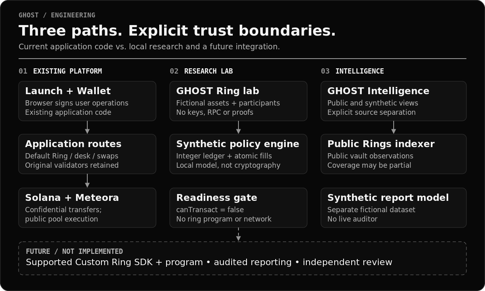
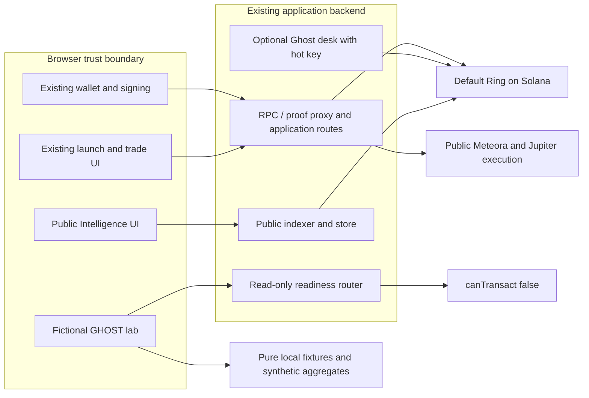

# Architecture and integration boundaries

**Status:** application research candidate, 2026-11-26. This document describes observed code and proposed integration gates; it is not a specification of audited Helius behavior.

## System context

### Existing mainnet path

`shared/src/privacy.ts` and the existing signing and keyring modules construct user-authorized operations against the Default Ring. `shared/src/routes.ts` combines supported public swaps with deposits and withdrawals; swaps against a public pool disclose public execution. `shared/src/ghost.ts` and `server/src/desk.ts` implement optional co-signed two-leg confidential settlement against inventory. The desk is a real counterparty, not an AMM or guaranteed liquidity service. Existing transaction validators are deliberately restrictive and must not be weakened to support an evolving Custom Ring SDK.

### Research path

`shared/src/custom-rings/config.ts` defines an immutable application research target and a closed execution state. `lab.ts` models fictional asset conservation, policy outcomes and atomic rollback using `bigint` and ephemeral in-memory maps. `intelligence.ts` accepts only a synthetic snapshot of the fixed participant set. `server/src/custom-rings/routes.ts` exposes readiness but rejects execution paths. `web/src/pages/ghost.ts` renders this model without importing wallet, proof, RPC or signing code; it reads the status endpoint only. The test participants, balances and Boolean approval switches are not real identities, authorization or cryptographic privacy.

### Public data path

`web/src/pages/ghost-intelligence.ts` reads the existing public Rings indexer endpoints. The data represents public protocol asset/vault observations and configured index coverage, not per-Custom-Ring assets or private owner balances. Unknown or unavailable data is not replaced by estimates. No live auditor, upload interface or attestation exists in this version.

## Proposed future boundary (not implemented)

A real integration requires a version-pinned SDK, verified network/program identity and activation, compatible prover artifacts, ring-specific enrollment/key lifecycle, approved operator and auditor responsibilities, settlement conformance, and independent security review. A new adapter should be separately reviewed and disabled by default. No environment setting in this candidate can enable live Custom Ring execution. Confidential devnet is the initial integration target; anonymous mode is separately gated. The Default Ring must remain usable independently. Do not use unaudited example circuits or publicly seeded proving keys for real funds.

The proposed report boundary is an aggregate, scoped report for a finalized snapshot, with source provenance, mint and ring identity, coverage and reconciliation, signed by an independently governed auditor or stronger independently validated proof where supported. The application should not ingest member viewing secrets or raw private transaction records as ordinary server data. Audited holdings do not prove beneficial ownership of unknown wallets or total insider positions. Small-cohort suppression in the synthetic lab is an illustration, not a complete privacy solution for real or repeated queries.

## Trust and failure register

| Boundary / risk | Current handling | Required future evidence |
| --- | --- | --- |
| Mainnet execution regression | Release-specific hash guard and prior validators retained | Full regression + independent code review |
| Wrong network/program or inactive ring | Research API has no network/program and execution is closed | Pinned release/identity checks, negative tests for mismatches and unavailable services |
| Unauthorized spending or half-fill | Synthetic approvals and rollback test only | Real SDK/program proof binding, both owners' authorizations and atomic failure tests |
| Operator power | Target disables permanent delegate; lab controls only fictional data | Independently verify role permissions, upgrade and pause powers, user recovery semantics |
| Key or customer data exposure | New research path accepts neither live keys nor private reports | Threat model and independent review of isolated audit/operational access |
| Incorrect aggregate | Exact integer arithmetic and fixed synthetic snapshot validation | Coverage reconciliation, finalized slots, independently verifiable attestation, disclosure policy |
| Misleading privacy claim | Public market execution and Default Ring counterparty visibility disclosed | Validate release-specific privacy behavior and publish accurate limitations |
| Dependency / supply chain | Original lockfile unchanged | Connected clean install, CI, advisory review, software bill of materials if required |
| Compliance and custody | No new live operator role in candidate | Independent qualified legal and operational assessment before live ring operation |

## Design decisions

- Preserve the current production code and deployment configuration. A research target must never act as an on-chain manifest.
- Prefer upstream-supported primitives and documented examples over new cryptography. Validate actual protocol behavior; do not assume simulation semantics are protocol semantics.
- Keep existing public execution, inventory settlement and future Custom Ring settlement distinct in UX and metrics.
- Keep the permanent delegate disabled in the target and require a fresh, explicit operator-power review if any authority changes.
- Use public or synthetic data only until independently reviewed reporting and governance are implemented.

See [platform architecture](../ARCHITECTURE.md), [privacy model](../PRIVACY_MODEL.md), [roadmap](ROADMAP.md), and [validation](VALIDATION.md).
