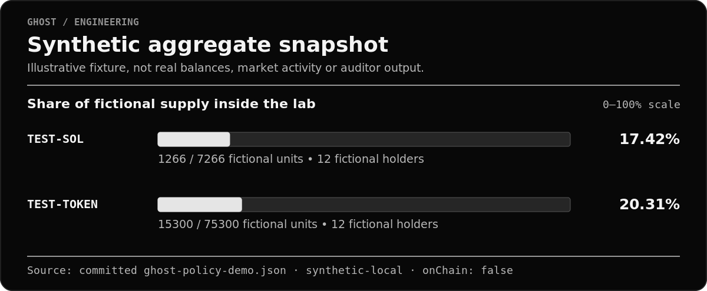

# Reproduce the synthetic settlement and reporting demo

**Scope:** fictional participants and balances, local state only. No private key, RPC, ZK proof, real token, network or deployed ring is involved.

```sh
npm run ghost:baseline
npm run ghost:check
npm run --silent ghost:demo
```

The deterministic output is stored at [evidence/ghost-policy-demo.json](../../evidence/ghost-policy-demo.json). Compare the output on a clean checkout with the reference fixture. All quantities are integer test units; the fixture is not production data.

| Scenario | Reference outcome | Invariant |
| --- | --- | --- |
| Successful fictional fill | Accepted | Two legs committed together |
| Second leg lacks balance | Rejected | Whole fill rolled back |
| Co-signer missing | Rejected | State unchanged |
| Blocked recipient | Rejected | State unchanged |
| Frozen sender | Rejected | State unchanged |
| Paused lab | Rejected | State unchanged |



The graphic is drawn from `ringShareBps`, `ringUnits`, `totalSupplyUnits` and `holderCount` in the committed demo fixture. It shows only the synthetic reporting contract, not audited private holdings, actual token supply, customer balances or proof of privacy. The creator-share fields are null, not estimated. Exact data remains available in the JSON.

See [validation](VALIDATION.md) for actual checks and blockers, [architecture](ARCHITECTURE.md) for boundaries, and [roadmap](ROADMAP.md) for real integration requirements.
