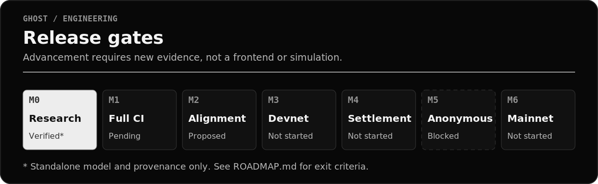

# Engineering roadmap and release gates

No milestone is represented as complete merely because a UI or simulation exists. The owner should assign reviewers and dates after Helius confirms the supported integration path.

| Milestone | Status | Exit evidence |
| --- | --- | --- |
| M0. Source provenance and research foundation | Standalone verified | v23 baseline checks, deterministic synthetic tests/demo, documented target and trust boundaries |
| M1. Reproducible application checkout | Partial — prior GitHub tests/type-check passed; build cancelled | Clean locked dependency install, all existing and new HTTP tests, complete TypeScript/Vite build, browser smoke results, dependency review, GitHub Actions green |
| M2. Upstream engineering alignment | Proposed | Maintainer feedback on supported SDK/program versions, governance activation, ring-specific policy semantics and CI conventions |
| M3. Supported confidential devnet integration | Not started | Official devnet ring artifacts and identity, test-only assets; validated enrollment, permitted operations and explicit failure cases; no production credentials |
| M4. Settlement and reporting review | Not started | Supported two-party settlement conformance with atomic failure, authorization and conservation; scoped finalized test reports with independent provenance review; no raw private user data in public analytics |
| M5. Anonymous-mode evaluation | Blocked on supported upstream release and review | Independently verified mode availability, privacy claims, auditor roles, policy conformance, operational and legal approval; no automatic mainnet enablement |
| M6. Production release | Not started | Audited compatible program/SDK, governance activation, security/legal signoff, key-management and incident/recovery review, staged full application rollout and independently verified operational readiness |

## M1 acceptance checklist

- `npm ci` on the pinned Node release; package-lock remains unchanged unless independently reviewed.
- `npm run verify` completes with all jobs green, including loopback HTTP contract tests. Reproduce the committed demo JSON byte-for-byte.
- Preview the research lab in a fresh browser profile. Confirm explicit simulation label, config export, policy rejections, both-leg rollback, reset and unavailable API fallback.
- Verify Intelligence handles partial/unavailable index data and never reports simulated holder counts as public data. Check narrow and desktop layouts, keyboard controls, readable focus and error announcements.
- Verify existing launch, wallet, swap, rings and token pages against the baseline in an isolated environment. No real-fund test is required for M1.
- Review dependency advisories and publication rights; record actual results in a new evidence record instead of rewriting historical failures.

## M2–M4 questions to resolve with maintainers

1. Which released SDK, program identity, test network and artifacts should an independent application pin? What can be exercised in a no-secrets public CI job versus a controlled devnet integration job?
2. What is the authoritative registration and authorization contract across modes? Which operations are subject to the selected block/freeze/co-sign/pause controls? What happens to pending settlements and lawful exits when a ring becomes unavailable?
3. Is two-leg settlement supported as one atomic transaction with the policy and authorization checks on both legs? Which integration harness is accepted for conformance testing?
4. What are the documented auditor permissions, ring activation and upgrade controls, data coverage and signed-report interfaces? Can aggregates be scoped without exporting raw member data?
5. What is the supported migration/recovery process for an app that already uses the Default Ring? No automatic conversion should be assumed.

## Release policy

The JSON target remains unchanged, including anonymous/open/all-assets as requested research parameters. Real membership, asset admission, operational powers and mode availability need separate review before live deployment. Keep the mainnet v23 application running until the independently reviewed M1 gates pass and a separate application rollout is approved. Do not equate a successful GitHub CI run with a deployed ring or a security audit.

Program B is tracked independently in [its validation gates](../../protocol/ghost-markets/docs/VALIDATION.md). A green application workflow is not evidence that the Anchor market program compiles or settles on-chain.
