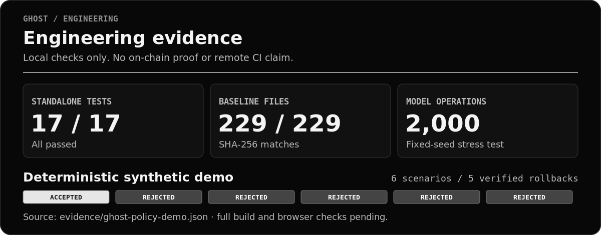

# Engineering validation record



**Date:** 2026-11-26 · **Scope:** local source candidate, not a security audit or on-chain test.

## Reproduced in the preparation environment

| Check | Result | Evidence |
| --- | --- | --- |
| Baseline integrity | PASS — 229/229 protected original v23 files | `npm run ghost:baseline`, [SHA-256 manifest](../../evidence/v23-baseline.json) |
| Scoped strict TypeScript and Node research tests | PASS — 17/17, zero failures | `npm run ghost:check`, [actual output](../../evidence/standalone-check.txt) |
| State-machine stress | PASS — fixed seed, 2,000 sequential synthetic operations; accepted and rejected cases, atomic fills, per-asset supply and nonnegative balance invariants | Included in standalone test count; not a real proof or exhaustive fuzz campaign |
| Deterministic demo | PASS — exact committed JSON reproduced, including accepted fill, five policy/balance rejections, rollback checks and synthetic aggregates | `npm run --silent ghost:demo`, [fixture](../../evidence/ghost-policy-demo.json) |
| Proposed upstream documentation patch | PASS in local scratch repo: staged whitespace check, `git apply --check`, apply and content comparison | [Add-only patch](../../contrib/helius/0001-docs-application-readiness.patch); not checked against current upstream clone |
| Workflow / issue template YAML | Parsed locally | Syntax parsing only, not a GitHub Actions run |

Node 22.16.0, npm 10.9.2, globally available TypeScript 5.8.3. The pinned repository Node is 22.22.0 and its locked TypeScript is 5.9.x; verify with those versions in a clean connected environment. No `node_modules` is included. The original `package-lock.json` remains byte-identical to v23; dependency versions were not changed.

### Actual coverage of standalone checks

Exact immutable research configuration and hard-disabled network status; synthetic transfer, deposit and withdrawal conservation; pause/block/freeze/co-signing behavior according to the lab model; atomic successful fill and second-leg failure rollback; invalid operations, assets, participants, amounts and approvals; bounded copied receipts; integer aggregate calculations and low-cohort suppression; malformed, short and sparse synthetic snapshot rejection; source wiring checks. These tests verify the model and selected source-level invariants, not actual upstream policy semantics, wallet security, anonymity or program compatibility.

The hash manifest was computed by comparing the supplied v23 archive with the imported v24 source, excluding documented changed paths and intentional repository packaging changes. It is a release-specific regression guard, not an authenticity signature, a behavior test, or a substitute for code review. The full original v23 archive contained 244 files; no original file was deleted in the v24 import. See `evidence/v23-baseline.json` for all protected and deliberately excluded paths.

## Blocked or not run

| Check | Status / blocker |
| --- | --- |
| Clean npm dependency install | Blocked: `npm ping --fetch-retries=0 --fetch-timeout=8000` returned `EAI_AGAIN registry.npmjs.org`; earlier v24 install also failed |
| Complete project typecheck, Vitest regression suite and production Vite/server build | Not verified; dependencies unavailable |
| New isolated HTTP test (`tests/custom-rings-http.test.ts`) | Written; not executed here because Express/Vitest installation is unavailable |
| End-to-end browser/visual smoke | Not executed in this pass; previous v24 browser navigation was blocked before assertions |
| GitHub Actions / branch protection | Workflow authored, not executed remotely; repository not created or modified |
| Full secret scan, dependency audit, source/license/asset clearance | Pending. Limited archive inventory and pattern review found no obvious secret file paths; one API-key-shaped value is in the known redaction test fixture `tests/platform.test.ts`. Pattern review is not a complete secret scan; do not publish without independent review. |
| Upstream patch compatibility and acceptance | Pending; scratch application succeeded, but no pinned upstream checkout or maintainer review verified |
| Helius application / PR | Draft only; not sent or opened |
| Actual Custom Ring devnet/mainnet, on-chain proofs, auditor, anonymous transfers | Not implemented or deployed; no real transaction or program identity verified |
| Independent security and legal review | Pending |

Preserve the earlier [v24 preparation record](../GHOST_VALIDATION.md); its 15-test result describes the earlier snapshot, not this engineering edition. The upstream official docs checked on 2026-11-26 continued to list Custom Rings in audit with a Q4 2026 target, and the security page expected audit conclusion in December. These are published targets, not guarantees of availability. The readiness status remains disabled.

## Reproduce on a clean connected checkout

```sh
npm ci
npm run verify
npm run --silent ghost:demo > evidence/ghost-policy-demo.json
git diff --exit-code -- evidence/ghost-policy-demo.json
```

Complete the browser, dependency, publication and independent review gates in [ROADMAP.md](ROADMAP.md) and [PUBLISHING.md](PUBLISHING.md). Append new dated evidence after actual runs rather than changing pending checks to passes by assumption. No real-fund deployment is authorized by this document.

## GitHub packaging revision — 2026-11-26

Re-executed the standalone suite on Node 22.16.0 and TypeScript 5.8.3: 17/17 passed; [new output](../../evidence/github-packaging-check.txt). The v23 hash check again matched 229/229 files; the demo reproduced byte-for-byte. Repository branding, links and metadata were updated without changing application execution code or the lockfile. Repository upload, full dependency/build/HTTP/browser verification, remote CI and upstream review are still pending.
