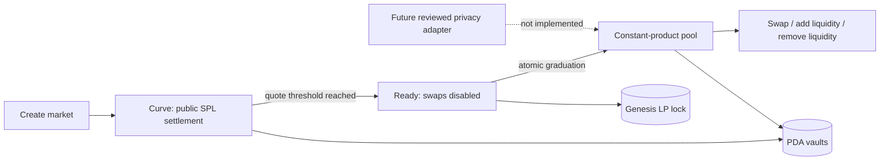

# GHOST Markets · Program B

**GHOSTRINGS / privacycash.fun — independent Solana market protocol research**  
Repository: [ghostrings/zolana](https://github.com/ghostrings/zolana) · Stage: **on-chain source candidate, not compiled, deployed or audited**

This is the next engineering step after [`protocol/markets` (V25 pricing RFC)](../markets/README.md). Program B is a separate Anchor workspace, with actual Solana instruction handlers and original SPL Token CPIs. It does not replace the working launchpad, and no existing execution route imports it.

> [!IMPORTANT]
> The implemented settlement path is **public**. Token amounts, identities, reserves, issuance, and LP balances are observable. No Custom Ring is generated, registered or activated by this workspace; no ZK proof is accepted and there is no anonymous/private settlement instruction. This source must not be used with real funds. The Rust/SBF build, local-validator conformance and security review are outstanding.

## Implementation

| Instruction | Responsibility |
| --- | --- |
| `create_market` | Create market PDA, fresh fixed-supply base mint, empty LP mint and three PDA-controlled SPL vaults. Mint full initial inventory to the base vault and revoke base mint authority atomically. Public immutable configuration; zero creator premint. |
| `swap` | Exact-input curve buy/sell before graduation and constant-product pool buy/sell after graduation. Minimum output, expected state version, deadline slot, fixed fee and actual reserve checks. Two public checked-transfer CPIs commit atomically. |
| `graduate` | Once the quote reserve meets its immutable threshold, latch Ready. Any fee payer can finalize once. Burn surplus unsold inventory to approximate terminal marginal price, preserve actual quote reserve and mint genesis LP shares into the lock vault. |
| `add_liquidity` | Deposit both assets proportionally; enforce maximum inputs and minimum LP shares; mint ordinary SPL LP tokens. |
| `remove_liquidity` | Burn a user's LP shares and transfer proportional reserves, subject to minimum outputs. Use live LP supply and preserve locked genesis liquidity. |



The dependency-free Rust market-math crate is used directly by the Anchor instruction processor. A separate BigInt reference calculates the same transitions and generates committed cross-language vectors. It is not a fake wallet or balance UI.

## Evidence

| Check | Result at packaging |
| --- | --- |
| V25 quote + new lifecycle reference | 31/31 Node tests passed |
| Seeded quote properties | 10,000 cases |
| Seeded lifecycle properties | 5,000 scenarios (multiple transitions each) |
| Committed cross-language vectors | 128 regenerated and matched byte-for-byte |
| Rust tests | Written, not executed here |
| Anchor / SBF build and IDL generation | Not executed here |
| Local-validator integration suite | Written, syntax-checked, not executed here |
| Devnet / mainnet | Not deployed; no real program address |

## Repository map

```text
protocol/ghost-markets/
  Anchor.toml                       localnet only
  Cargo.toml                        separate Rust workspace
  crates/market-math/               pure checked arithmetic and lifecycle
  programs/ghost-markets/           Anchor instructions, accounts, events
  reference/                        BigInt model and 128 CSV vectors
  tests/                            reference tests and local-validator suite
  scripts/test-localnet.sh          isolated local test runner
  docs/ACCOUNT_MODEL.md             constraints, lifecycle, economics
  docs/SETTLEMENT_CONTRACT.md       future proof binding requirements
  docs/VALIDATION.md                evidence and review gates
  evidence/                         local reference test output
```

## Reproduce the locally verified checks

Run these from the **Zolana repository root**, with Node 22. No npm install, wallet, RPC or Solana tools needed for reference tests:

```sh
node --test protocol/ghost-markets/tests/quote.test.mjs protocol/ghost-markets/tests/lifecycle.test.mjs
```

For the independent Rust math test, with Rust installed:

```sh
cd protocol/ghost-markets
mkdir -p target
rustc --edition=2021 --test crates/market-math/src/lib.rs -o target/market-math-tests
target/market-math-tests
```

These commands are separate from the existing application checks. Rust fixture conformance is pending until run by CI or a reviewer.

## Next gate: compile and exercise the actual program

Use the pinned **Anchor 0.32.1** and **Solana CLI 2.3.0** pair (recommended in [Anchor 0.32.1 release notes](https://www.anchor-lang.com/docs/updates/release-notes/0-32-1)). Install them using the official [toolchain instructions](https://www.anchor-lang.com/docs/installation). This workspace deliberately retains the existing root package lock and uses the parent project's locked `@solana/web3.js` and `@solana/spl-token` for integration tests. No new npm dependency is needed.

From the root of the uploaded Zolana repository:

```sh
npm ci
bash protocol/ghost-markets/scripts/test-localnet.sh
```

The script creates separate local-only wallet/program keys under ignored `target/`, syncs the program ID, builds the SBF program, starts a local validator, and runs the actual instruction tests using newly generated test wallets. It refuses non-localnet configuration; the test also refuses non-loopback RPC. `anchor keys sync` modifies the source and Anchor.toml program ID in the working tree; this is expected. Never commit or publish any keypair, and never reuse the local test keys on another cluster.

A real program address does not exist yet. The declaration in the source is only a placeholder. No `.so`, IDL or Cargo.lock has been fabricated; the first successful build must generate and review these artifacts, including a locked transitive dependency graph. Do not label builds reproducible until that is done.

### GitHub Actions

[Program B workflow](../../.github/workflows/ghost-markets-program.yml) runs reference checks and the dependency-free Rust test on changes. Manually dispatch it for the full build and local-validator suite. No secrets, production deployment, or live chain transactions are configured. Full workflow results are pending.

## Design choices that need review

- Fixed-supply original SPL token, 6 decimals, zero creator premint. At graduation, disclosed unsold inventory is burned. No creator or protocol revenue withdrawal in this version.
- Original SPL Token quote asset, no freeze authority. Wrapped SOL is an example; some common stablecoins have freeze authorities and are intentionally rejected. Quote-mint integrity and UI admission need review.
- All amounts are base units. Fee is rounded up, output rounded down; maximum 100 bps (1%). Fees remain in reserves. Virtual reserves are nonspendable.
- No Metaplex metadata, external pool migration, price oracle, LP incentives, emergency withdrawal or production frontend integration. Names/symbols/URI are public market metadata only.
- Initial LP shares are program-controlled and not redeemable through any supplied instruction. An upgrade authority could replace the logic, so this is **not** proof of an immutable lock.
- Program B is public, and will stay public until independently reviewed proof integration exists. See [settlement contract](docs/SETTLEMENT_CONTRACT.md).

Read [account model](docs/ACCOUNT_MODEL.md) and [validation gates](docs/VALIDATION.md) before review. No license change is implied; parent repository publication and contribution terms apply.
