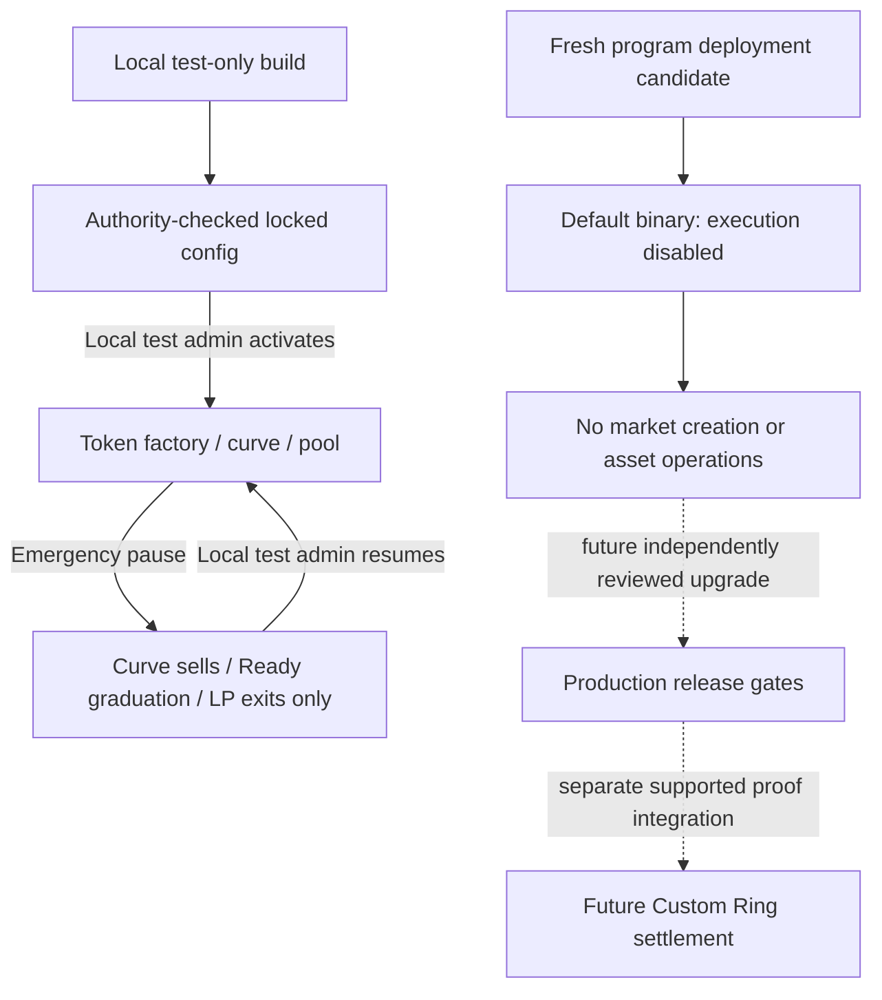

# GHOST Markets · Program B · V27

**GHOSTRINGS / privacycash.fun — independent Solana market protocol research**  
Repository: [ghostrings/zolana](https://github.com/ghostrings/zolana) · Stage: **locked mainnet deployment candidate, not compiled/tested on SBF or deployed as V27**.

The V26 program compiled and passed its local-validator lifecycle suite on the owner's Ubuntu machine. V27 retains the same market math and public SPL settlement handlers and adds a protocol-wide deployment lock, authority management and a locked-release preparation and verification path. The exact compatible `Cargo.lock` supplied by the owner is now committed in the source package.

> [!IMPORTANT]
> The **default V27 executable is intentionally inactive**: it refuses all market instructions, even if an administrator tries to activate it. Market execution and pause/exit tests require the separate `local-market-testing` feature, which must never be deployed to a public cluster. This is not an approved real-fund exchange, a Helius Custom Ring or a private AMM. V27 needs fresh SBF compilation, actual validator tests and independent review. No mainnet program address exists yet.

## Instructions

| Instruction | Responsibility |
| --- | --- |
| `initialize_protocol` | Verify the loader upgrade authority; create the singleton config in locked mode. |
| `set_protocol_mode` | Test-feature only: admin activation/resume, admin/pauser pause. The default binary always rejects it. |
| `nominate_admin` / `accept_admin` | Two-step admin transfer; no direct takeover by an unapproved caller. |
| `set_pauser` | Admin selects the emergency pauser. |
| `create_market` | Fixed-supply SPL mint, market PDA and vaults, no creator premint, mint authority revoked. |
| `swap` | Public exact-input curve or constant-product buy/sell; checked reserve, slippage, state and expiry controls. |
| `graduate` | Permissionless Ready-to-Pool transition; burns disclosed surplus unsold inventory, locks genesis LP. |
| `add_liquidity` / `remove_liquidity` | Proportionate public SPL deposits, LP minting, burn and reserve withdrawals. |

All five market instructions are guarded and now require the protocol PDA. The new ABI is intentionally incompatible with V26. Existing application routes remain separate and unchanged.



The public state machine retains V26's market account layout and dependency-free math. The separate local reference and 128 committed vectors are unchanged. See [control model](docs/CONTROL_MODEL.md), [account model](docs/ACCOUNT_MODEL.md) and [settlement contract](docs/SETTLEMENT_CONTRACT.md).

## Evidence and tests

| Check | Scope / status |
| --- | --- |
| V26 Rust workspace | Owner-reported 12/12 passed |
| V26 local-validator | Owner-reported 6/6 passed after duplicate token-account setup fix |
| V26 binary fingerprint | `ae857c4dcadb33370e7effc192e618c9f65e3369bc0be74ced95076cfd4357d9` (local-only identity, not V27) |
| V27 supplied `Cargo.lock` | Exact owner file, SHA-256 checked |
| V27 local reference | 31 legacy reference tests + 3 new pure release verifier tests |
| V27 Rust/SBF and two local validator variants | Required; not run in the packaging environment |
| Mainnet deployment | Not performed; no fabricated address or activation |

See [validation and evidence](docs/VALIDATION.md). Historical passes do not certify the new control instructions or the new binary.

## Run with the existing Linux toolchain

Node 22.22.0, Anchor 0.32.1 and Solana CLI 2.3.0 are the intended versions. Preserve the compatible [Cargo.lock](Cargo.lock); **do not run `cargo generate-lockfile`**. Install root npm dependencies if missing. No new npm or Rust dependencies are introduced.

From the repository root:

```bash
node --test protocol/ghost-markets/tests/quote.test.mjs protocol/ghost-markets/tests/lifecycle.test.mjs protocol/ghost-markets/tests/release-verify.test.mjs
cd protocol/ghost-markets
sha256sum -c evidence/Cargo.lock.sha256
bash scripts/test-localnet.sh
```

The runner uses local-only keypairs, not the CLI wallet. It tests both the local-only enabled variant and default locked variant, ending with a locked local-identity binary. `anchor keys sync` changes the declaration and localnet ID in your working directory; this is expected. No live transactions are sent. Never publish keys or deploy a test-enabled binary.

### Direct mainnet preparation — no public devnet deployment required

After both V27 validator runs pass:

```bash
bash scripts/prepare-mainnet.sh
bash scripts/deploy-mainnet.sh preflight
```

These commands prepare a fresh locked candidate under a private Linux key directory and perform a read-only mainnet check. They do not send funds or deploy. Follow the full [V27 mainnet runbook](docs/MAINNET_V27.md) for independent review, explicit reviewed-hash approval, funding, an optional fresh locked deployment and byte verification. A separate future reviewed upgrade is required for operational markets. Never use the locked binary as an upgrade over an existing market.

## GitHub Actions

[Program B workflow](../../.github/workflows/ghost-markets-program.yml) uses the supplied lockfile rather than regenerating it. It runs reference checks on relevant pushes and PRs, with a manual dispatch for Rust, SBF and both actual validator variants. CI does not deploy or expose generated keypairs. The final uploaded artifact is a locked binary for its test identity only, not a mainnet release. Verify the latest workflow after your manual upload.

## Remaining production risks

Quote-asset integrity and admission, stalled-launch refunds, full emergency-exit design, public market data, user-facing metadata and frontend, monitoring, independent audit and secure upgrade authority are not complete. The upgrade authority can replace all checks. The current program has no private settlement adapter, custom ring registration, or market-specific ZK proof. Its test-market reserves, amounts and parties are public. Keep existing mainnet production routes independent of this candidate.

Original V25 pricing RFC: [protocol/markets](../markets/README.md). No license change, upstream affiliation or Helius approval is implied.
